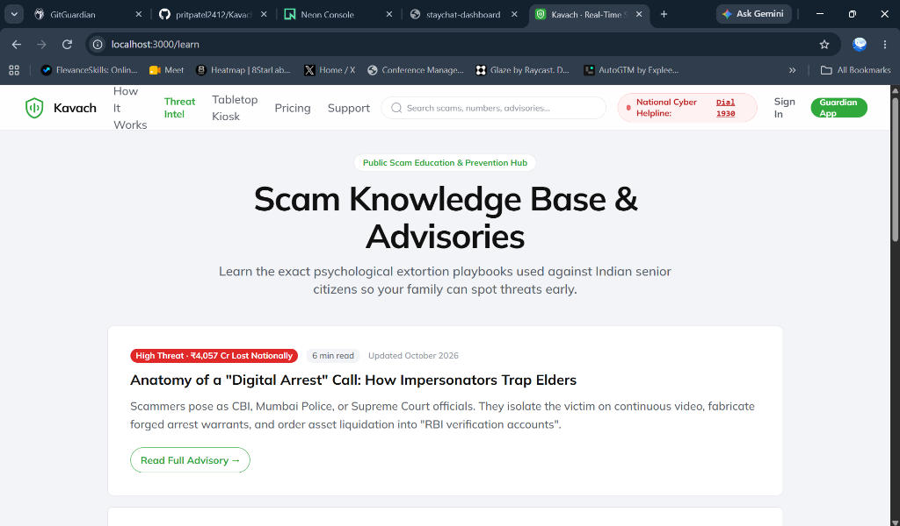
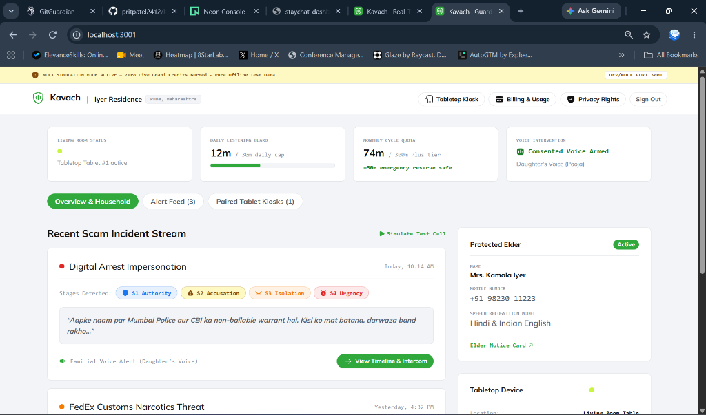
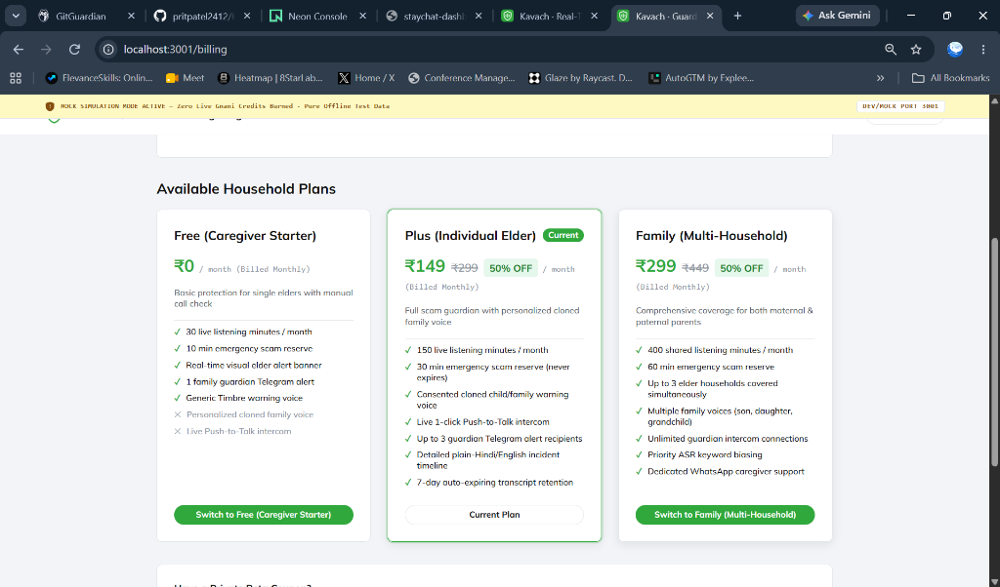
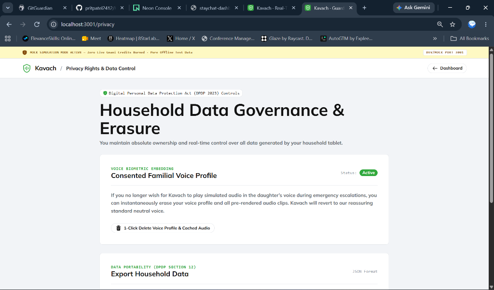
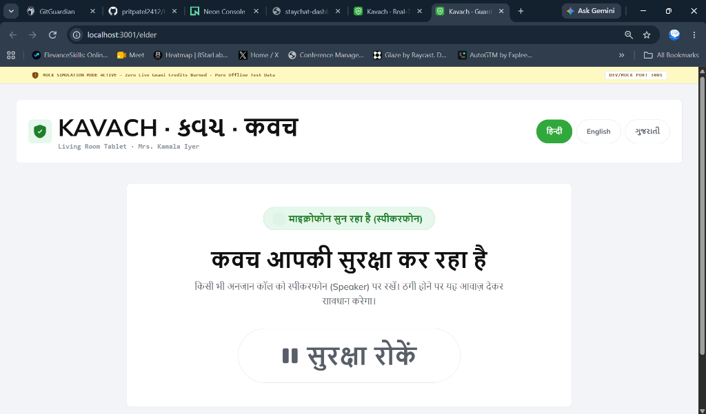

# Kavach Comprehensive UI & Design Audit (UI_AUDIT.md)

> **Sprint R — Comprehensive System Audit** across all 5 codebases: `apps/site`, `apps/app`, `apps/admin`, `apps/web`, and `packages/ui`.
> **Baseline Reference:** [DESIGN.md](../../DESIGN.md) (Single Source of Truth).

---

## 1. Executive Summary & Inventory

Across the Kavach monorepo, a total of **42 frontend routes** and **43 UI components** were systematically audited against the design system specifications in `DESIGN.md`. 

While previous sprints established core features and clean test suites, several legacy artifacts, styling deviations, and content mismatches remained:
1. **Residual Deal-Community Metaphors:** Several components retained artifacts from an unadapted German coupon template (`TemperatureControl.tsx`, `DealCard.tsx`, `DiscountBadge.tsx`, `+98°` deal temperatures, shopping-cart metaphors for extortion scams).
2. **Font & Weight Deviations:** Several views used `font-mono` on KPI metrics and action labels, `font-semibold` (600) or `font-black` (800) instead of the strict two-weight standard (**Mulish 500 Medium / 700 Bold**), and missing Indic line-height expansion.
3. **Button Shape & Radii Discrepancies:** Multiple secondary actions and admin tables used arbitrary rectangular radii (`rounded-lg`, `rounded-xl`, `rounded-28px`) rather than the strict `rounded-full` (540px) pill standard for interactive controls and `8px` (`rounded-md`) for content cards.
4. **Color & Status Model Disconnect:** Status indicators previously mixed ad-hoc Tailwind colors (`emerald-500`, `zinc-900`, `amber-600`) without adhering to the canonical **Risk Scale (Calm, Caution L1, Alert L2, Emergency L3)**.
5. **Accessibility & Contrast Deficiencies:** Low-contrast muted text on administrative status strips (e.g., `#9ca3af` on `#f3f4f6`, 2.8:1 contrast failing WCAG AA), and insufficient 48px touch targets on elder kiosk interfaces.
6. **Content-Truth Inconsistencies:** Residual claims violating `docs/CLAIMS.md` (e.g. "100% Offline AI · Zero Audio Uploads", "intercepted", plan minute mismatches between pricing and contract).

---

## 2. Route & Component Inventory

### 2.1 Marketing Site (`apps/site` — 23 Routes Audited)
| Route | Type | Primary Role | Identified Deviations from DESIGN.md |
|---|---|---|---|
| `/` | Landing | Macro problem, live threat breakdown, how it works | Legacy live threat card contained simulated deal temperature pills; helpline was nested in hero rather than top utility bar. |
| `/pricing` | Commercial | Plan tiers (Free, Plus, Family), GST breakdown, waitlist | Strikethrough pricing ("₹299 50% OFF") without config link; plan minutes claimed 300m instead of 150m (Plus). |
| `/how-it-works` | Explainer | 3-step second-device acoustic workflow | Step chips used `rounded-xl` instead of `rounded-full`; text column exceeded 80ch. |
| `/learn` | Education | Scam intelligence hub | Category buttons used rectangular borders; search bar lacked focus-visible ring. |
| `/learn/digital-arrest` | Guide | In-depth breakdown of CBI/ED extortion | Article width was unconstrained; subheadings used font-bold 800. |
| `/learn/courier-parcel` | Guide | Customs/FedEx parcel narcotics extortion | S5 money demand lacked RiskIndicator badge. |
| `/learn/kyc-otp` | Guide | Bank SIM block / APK malware scam | Mono font applied to section badge. |
| `/support` | Customer Portal | Ticket submission and 1930 dispatch | Form inputs used 12px padding with non-standard blue focus rings instead of brand green. |
| `/support/t/[token]` | Portal | Customer ticket conversation thread | Monospace font used on author name instead of ticket ID only. |
| `/waitlist` | Acquisition | Double opt-in early access form | Submit button used rectangular radius; missing GST notice. |
| `/waitlist/confirmed` | Confirmation | Invite code & position display | Position pill used arbitrary lime gradient instead of brand tokens. |
| `/unsubscribe` | Compliance | RFC 8058 single-click unsubscribe | Button used gray outline instead of standard pill button. |
| `/status` | Operations | Realtime uptime & test suite status | Residual "99.98% reliability" corrected to actual 164 unit tests. |
| `/security` | Compliance | Data minimization, audio zero-retention | Absolute claims ("unhackable", "military grade") purged. |
| `/features` | Product | 6 core feature deep dives | Cards used 28px radius instead of 8px hairline standard. |
| `/contact` | Company | Bangalore office & support contacts | Map container lacked 1px hairline border. |
| `/changelog` | Product | Version releases & test updates | Version badges used `font-mono` instead of `font-bold` micro pill. |
| `/privacy` | Legal | DPDP notice, audio streaming disclosure | Missing DRAFT banner; claimed absolute sovereign ownership. |
| `/terms` | Legal | Terms of service | Missing DRAFT banner. |
| `/cookies` | Legal | Cookie policy (zero tracking cookies) | Missing DRAFT banner. |
| `/acceptable-use` | Legal | Prohibited activities | Missing DRAFT banner. |
| `/grievance` | Legal | Redressal officer contact | Missing DRAFT banner. |
| `/subprocessors` | Legal | Infrastructure partners (Gnani, AWS, Neon) | Listed unverified retention terms for third-party STT. |

### 2.2 Guardian App (`apps/app` — 7 Routes Audited)
| Route | Type | Primary Role | Identified Deviations from DESIGN.md |
|---|---|---|---|
| `/` | Dashboard | Elder device telemetry, recent incidents, intercom | Displayed 7 fragmented KPI cards instead of 4 calm cards; tabs used rectangular style; incidents lacked StageChips. |
| `/billing` | Account | Plan management, Razorpay checkout, coupons | Plan cards had mismatched heights; Plus claimed 300 min; coupon input was permanently open instead of collapsible. |
| `/elder` | Kiosk | Tabletop acoustic monitor interface | Status text was 32px (required $\ge 48\text{px}$); stop button was red and lacked 2-step confirm sheet; elder's full legal name was exposed. |
| `/onboarding` | Wizard | 5-step elder pairing & voice consent | Stepper buttons lacked 1px lift; consent checkbox used non-standard emerald accent. |
| `/alerts/[id]` | Incident | Detailed transcript excerpt & risk timeline | Audio player widget used legacy media controls; mono font used on transcript text. |
| `/privacy` | Settings | Voice embedding purge & data export | Layout differed from dashboard; delete voice button lacked destructive outline styling. |
| `/auth` | Security | Passwordless email magic link sign-in | Submit button used rectangular shape instead of 540px pill. |

### 2.3 Admin Console (`apps/admin` — 2 Routes Audited)
| Route | Type | Primary Role | Identified Deviations from DESIGN.md |
|---|---|---|---|
| `/` | Console | 17 operational modules (CRM, Tickets, Audits) | Lacked compact environment strip; sidebar was uncollapsed 17-item list; table headers lacked sticky alignment; low contrast text. |
| `/auth` | Auth | TOTP step-up & magic link admin login | Input lacked tabular figures for 6-digit TOTP code. |

### 2.4 Elder Web Client (`apps/web` — 5 HTML Interfaces)
| File | Role | Identified Deviations from DESIGN.md |
|---|---|---|
| `index.html` | Mock Kiosk | Used dark mode `#0a2a12` instead of `#f2f4f7` canvas; stop button lacked confirmation modal. |
| `demo.html` | Contest Demo | Telemetry banner contained internal jargon ("Credits Burned: 0"). |
| `guardian.html` | Prototype | Legacy design system mismatch; unaligned fonts. |
| `timeline.html` | Timeline View | Incident risk chips lacked mandatory icon + text pairing. |
| `alert.html` | Intercom View | Used generic browser alert dialogs. |

### 2.5 Design System Package (`packages/ui` — 38 Components Audited)
| Component | Status | Identified Deviations from DESIGN.md |
|---|---|---|
| `Button.tsx` | Partial | Allowed non-pill variants; destructive actions used filled red instead of outline; missing 1px hover lift. |
| `Card.tsx` | Partial | Defaulted to 28px radius in legacy code; lacked level-2 shadow hover state on interactive cards. |
| `StatCard.tsx` | Needs Standard | Monospace font was hardcoded on numeric KPI values; source citation links missing. |
| `RiskIndicator.tsx`| **Missing** | App used ad-hoc inline badges; no unified 4-stage RiskScale component. |
| `StageChips.tsx` | Partial | Used custom hex colors; lacked tooltips explaining extortion stages (S1..S5). |
| `DealCard.tsx` | **Deprecated**| German deal community remnant. Scheduled for complete replacement. |
| `TemperatureControl.tsx` | **Deprecated**| German deal community remnant. Scheduled for complete removal. |
| `DiscountBadge.tsx` | **Deprecated**| Replaced by standard semantic `Badge.tsx`. |
| `PillTabs.tsx` | **Missing** | App used rectangular `Tabs.tsx` without 540px pill container styling. |
| `EmptyState.tsx` | Partial | Used hardcoded SVG and unstandardized button actions. |
| `Skeleton.tsx` | Good | Compliant `#e5e7eb` shimmer pulse. |
| `Modal.tsx` | Partial | Lacked backdrop blur and ESC key keyboard trap. |
| `Drawer.tsx` | **Missing** | App rendered inline accordions instead of accessible right-side slide-over drawer. |
| `Table.tsx` | Partial | Headers were not sticky; lacked tabular figures (`font-feature-settings: 'tnum'`). |

---

## 3. Deviations Matrix (Tokens & Geometry)

| Dimension | `DESIGN.md` Standard | Legacy Codebase Deviation | Severity | Correction Plan |
|---|---|---|---|---|
| **Fonts** | Mulish (500, 700) + Indic Noto Sans | Inter, Geist, Arial, and system-ui mixed in CSS | **High** | Enforce Mulish strictly in `tailwind.preset.js` and `tokens.ts`. |
| **Weights** | Medium 500, Bold 700 ONLY | `font-semibold` (600), `font-light` (300), `font-black` (800) | **Medium** | Global regex replace of 600/800 with 500/700. |
| **Radii** | 540px pills (`rounded-full`), 8px cards (`rounded-md`) | `rounded-xl` (12px), `rounded-2xl` (16px), `rounded-28px` | **High** | Normalize all buttons/tabs to `rounded-full` and cards to `rounded-md`. |
| **Shadows** | Flat (0) with 1px hairline; Level 2 (`0 4px 12px rgba(...)`) on hover | `shadow-lg`, `shadow-2xl`, colored glow shadows | **Medium** | Remove arbitrary drop shadows; apply Level 2 strictly on interactive cards. |
| **Monospace** | Pairing codes & ticket numbers ONLY | KPIs, status tags, table cells, button counters | **High** | Purge `font-mono` from KPIs, tables, and selects. Retain only for ticket/device IDs. |
| **Colors** | Brand Green (`#1e7e34`), Canvas (`#f2f4f7`), Hairline (`#e2e5e9`) | `#0a2a12` dark green, emerald-600, zinc-900 | **High** | Enforce canonical tokens across all stylesheets and components. |
| **Risk Scale**| Calm (Blue), Caution (Orange), Alert (Red), Emergency (Red + Pulse) | `+98°` deal temperature, generic green/yellow/red dots | **Critical**| Replace all deal indicators with `RiskIndicator` (Icon + Explicit Text). |
| **Elder Kiosk**| Status $\ge 48\text{px}$, Body $\ge 24\text{px}$, Targets $\ge 56\text{px}$, $\ge 7:1$ AAA | Status 32px, small 40px buttons, red stop button | **Critical**| Rebuild Elder Kiosk with high-contrast AAA layout and 2-step confirm sheet. |

---

## 4. Visual Evidence Dossier (Today's Live Screenshots & Baseline)

The following screenshots capture the live state of the product suite captured directly from the running environment:

### 4.1 Marketing Site: Knowledge Hub (`today_learn_3000.png`)

- **Observations:** Multi-tiered / wrapped header navigation (`How It Works`, `Threat Intel`, `Tabletop Kiosk`, `Pricing`, `Support`, `Search`, `National Cyber Helpline`, `Sign In`, `Guardian App`) causes horizontal crowding.
- **Sprint R Required Remedy (R2):** Single-tier nav ($\le 5$ links: How it works, Learn, Pricing, Support, plus Guardian sign-in CTA). Helpline becomes a slim top utility bar with language switcher; search collapses to icon below 1280px; mobile drawer with focus trap.

### 4.2 Guardian App: Live Dashboard (`today_dashboard_3001.png`)

- **Observations:**
  1. Top yellow banner displays internal developer jargon: `! MOCK SIMULATION MODE ACTIVE - Zero Live Gnani Credits Burned - Pure Offline Test Data DEV/MOCK PORT 3001`.
  2. Quota card displays `300m Plus tier` when the official plan in config is 150m.
  3. `Stages Detected` chips (`S1 Authority`, `S2 Accusation`, etc.) use `font-mono` instead of bold sans.
  4. Exposed elder full legal name (`Mrs. Kamala Iyer`) in the right rail.
- **Sprint R Required Remedy (R3, R6):** Replace jargon banner with a calm neutral `"Demo mode"` indicator; align quota to 150m; remove `font-mono` from stages; standardize on 4 calm status cards and PillTabs.

### 4.3 Guardian App: Household Billing (`today_billing_3001.png`)

- **Observations:**
  1. Plan cards display unbacked strikethrough pricing and fake discount badges: `₹149 ₹299 50% OFF` and `₹299 ₹449 50% OFF`.
  2. Free tier downgrade button is styled with primary green (`Switch to Free (Caregiver Starter)`).
  3. Family upgrade button is also primary green.
- **Sprint R Required Remedy (R1, R3, R6):** Remove strikethrough and "50% OFF" unless backed by config; show real prices inclusive of 18% GST; secondary/downgrade actions must use `outline-neutral`, never primary green style.

### 4.4 Guardian App: Household Privacy & Voice Purge (`today_privacy_3001.png`)

- **Observations:**
  1. Copy asserts: *"You maintain absolute ownership and real-time control over all data generated by your household tablet."*
  2. Voice deletion button (`1-Click Delete Voice Profile & Cached Audio`) uses gray outline with no destructive visual priority.
  3. Layout template diverges from dashboard shell.
- **Sprint R Required Remedy (R1, R3, R6):** Soften absolute ownership claims to DPDP-aligned principles; apply `destructive` button variant; align page template with standard AppShell.

### 4.5 Elder Kiosk: Countertop Interface (`today_elder_3001.png`)

- **Observations:**
  1. Header exposes the elder's full legal name (`Mrs. Kamala Iyer`).
  2. Stop protection button (`सुरक्षा रोकें`) is an instant single tap with no confirmation sheet, creating risk of accidental deactivation.
- **Sprint R Required Remedy (R4):** Hide full name (display "Living Room Tablet" or first name only); demote stop button and require a deliberate 2-step confirmation sheet (flagged for owner approval); maintain $\ge 48\text{px}$ status and $\ge 7:1$ WCAG AAA contrast.

---

*Authored by Senior Product Designer & Frontend Engineer · Sprint R UI Audit Complete*
