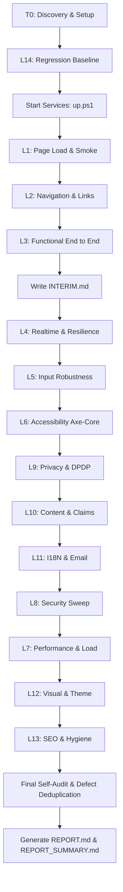

# Kavach Full-System Test Plan (Phase T0)

> **Document:** `docs/testing/PLAN.md`  
> **Sprint:** T ("Full-system test campaign and evidence report")  
> **Standard:** ISO/IEC/IEEE 29119 Software Testing Standard compliant  
> **Execution Constraint:** Zero paid Gnani credits (100% mocked offline speech pipeline), synthetic test data only, Windows/PowerShell compatible.

---

## 1. Test Strategy & Objectives

The primary goal of Sprint T is an exhaustive, verifiable, and deterministic verification of the entire Kavach system across all software layers: from low-level audio framing and detector algorithms to Next.js user interfaces, operational admin workflows, and cloud database integrations.

### Guiding Principles
1. **Evidence or it Did Not Happen:** Every test marked `PASS` must have a corresponding artifact (Playwright screenshot, HAR trace, assertion log, or JSON report) stored under `docs/testing/artifacts/` with an immutable file link.
2. **Deterministic & Isolated:** Tests must never depend on live external network connections, paid Gnani credits, or real SMTP mailboxes. All data must be seeded synthetically via `scripts/seed_demo_data.py`.
3. **Strict Defect Protocol:** The tester must never alter application code (`apps/*`, `packages/*`) to make a test pass. Failures must be logged in `docs/testing/defects.csv` with reproduction steps, severity (`S0`–`S3`), suspected root cause, and suggested fix.
4. **Repeated Runs for Stability:** Critical E2E scenarios must be executed 3 times to calculate pass rate; any test with pass rate $< 3/3$ is classified as `FLAKY` in `docs/testing/flaky.csv`.

---

## 2. Test Layer Hierarchy & Stable Identifier Schema

Each automated check and scenario is cataloged under a stable identifier: `T-<AREA>-<NNN>`.

```
+-------------------------------------------------------------------------------+
| Layer | Area Code  | Description                                              |
+-------+------------+----------------------------------------------------------+
| L14   | REG        | Regression Baseline (Pytest, eval suite, theme audit)    |
| L1    | SMOKE      | Page Load, Viewport Matrix, Hydration, Console Integrity |
| L2    | NAV        | Crawl, Internal & External Link Graph, Deep Links, Menus |
| L3    | E2E        | Full Functional User Scenarios (Marketing, App, Admin)   |
| L4    | RESIL      | Realtime WebSockets, Reconnect, Gating, Outbox Retry     |
| L5    | ROBUST     | Input Robustness (XSS, SQLi, Unicode, Large Payloads)    |
| L6    | A11Y       | Axe-Core, Keyboard Navigation, Contrast, Zoom Reflow     |
| L9    | PRIV       | Data Privacy, DPDP Purge, Zero Raw Audio Audit           |
| L10   | BRAND      | Claims Audit, Placeholders, Brand Rebranding Integrity   |
| L11   | I18N       | Localized Templates (en/hi/gu), RTL/Indic Typography     |
| L8    | SEC        | Auth Isolation, CSRF, CORS, IDOR, Header Sweeps          |
| L7    | PERF       | Lighthouse Metrics, WebGL Soak Test, API Load Benchmark  |
| L12   | VISUAL     | CoinCompass Theme Integrity, Screenshot Visual Baselines |
| L13   | HYGIENE    | SEO, Robots, Sitemap, Manifest, Feeds, Security.txt      |
+-------------------------------------------------------------------------------+
```

---

## 3. Test Layers Detail & Acceptance Criteria

### L14: Regression Baseline (`T-REG-001` .. `T-REG-010`)
- **Execution:** Run pytest on 139 tests in `apps/api/tests/`, `packages/detector/tests/`, and `eval/tests/`.
- **Criteria:** 100% pass rate (zero failures, zero errors).
- **Benchmark:** Evaluation harness (`eval/run_eval.py` and `eval/run_blind.py`) must meet established synthetic text metrics without paid credits.

### L1: Page Load & Smoke (`T-SMOKE-001` .. `T-SMOKE-050`)
- **Matrix:** 27 marketing routes, 8 app routes, 3 admin routes, and 4 static web demo pages.
- **Viewports:** Mobile (375x812), Tablet (768x1024), Desktop (1440x900).
- **Browsers:** Chromium (all routes); Firefox and WebKit (top 15 core routes).
- **Assertions:** HTTP 200, 0 console errors, 0 unhandled promise rejections, 0 failed network requests (excluding intentional 401s), no React hydration mismatch warnings, valid `<title>` and `<meta name="description">`.

### L2: Navigation & Link Integrity (`T-NAV-001` .. `T-NAV-030`)
- **Crawl:** Recursive graph traversal starting from `/`, `/pricing`, `/how-it-works`, `/help`, and `/auth`.
- **Integrity:** Every internal link resolves with 200 OK. Every external link tested via HEAD/GET request.
- **Components:** 5-column footer links, mobile hamburger menu (open/close, focus trapping, Escape key), language switcher persistence (EN/HI/GU across pages), deep link refreshes without 404.

### L3: Functional End-to-End (`T-E2E-001` .. `T-E2E-060`)
- **E2E-MKT:** Marketing landing, pricing monthly/annual billing calculation, plan selection, valid/expired coupon codes, FAQ accordions.
- **E2E-WAIT:** Waitlist submission -> outbox email generated -> double opt-in verification link clicked -> status transitions to `confirmed` -> admin cohort invite code issued -> unsubscribe portal respected.
- **E2E-AUTH:** Admin magic link dispatch -> verification -> mandatory RFC 6238 TOTP -> step-up reauth modal -> session termination on logout.
- **E2E-GUARD:** 5-step onboarding wizard, household registration, explicit consent check, voice enrollment, paired tablet device health monitoring.
- **E2E-DEMO:** Tabletop kiosk mode, judge panel simulation, stage 1-5 scam escalation, personalized familial voice warning playback, caregiver Telegram notification dispatch.
- **E2E-SUPP:** Public support ticket submission -> P0 scam emergency auto-dispatch -> customer magic portal reply -> staff internal notes vs public reply -> CSAT rating.
- **E2E-ADMIN:** Operations dashboard telemetry, household directory suspension, device revoking, feature flag toggling, export center downloads.
- **E2E-COUPON:** 50-parallel concurrent redemption race test proving zero over-redemptions.

### L4: Real-Time & Resilience (`T-RESIL-001` .. `T-RESIL-020`)
- **WebSockets:** Full framing test (1024-byte chunks, 16 kHz PCM16).
- **Gating:** Client-side RMS silence threshold verification (no silence uploaded).
- **Server Restart:** Client automatic exponential reconnect loop without session crash.
- **Outbox Resilience:** Simulated SMTP downtime -> outbox backlog queued -> auto-dispatched on reconnect.

### L5: Form & Input Robustness (`T-ROBUST-001` .. `T-ROBUST-025`)
- **Payloads:** Empty fields, ultra-long strings (10,000 chars), script injection (`<script>alert(1)</script>`), SQL injection (`' OR 1=1 --`), Unicode Indic text (Hindi, Gujarati, Tamil, Marathi, emoji), and CRLF carriage returns.
- **Double Submit:** Rapid click prevention and atomic locking on submission buttons.

### L6: Accessibility & Inclusive Design (`T-A11Y-001` .. `T-A11Y-020`)
- **Axe-Core:** Automated scan targeting 0 critical or serious violations on key pages.
- **Keyboard Walkthrough:** Full tab order traversal, visible focus rings, modal focus restoration.
- **Sensory:** `prefers-reduced-motion` respected (WebGL / GSAP pauses), 200% zoom text reflow at 320px width without horizontal clipping.

### L9: Data Protection & DPDP Privacy (`T-PRIV-001` .. `T-PRIV-015`)
- **Zero Raw Audio:** File system and database audit proving no raw PCM/WAV recorded calls are retained.
- **Retention Purge:** Verification of `purge_old_events()` pruning transcripts $> 7$ days.
- **DSR Queue:** 30-day statutory SLA fulfillment for data export and permanent deletion.

### L10: Claims, Content & Brand Configuration (`T-BRAND-001` .. `T-BRAND-015`)
- **Claims Traceability:** Every number on marketing pages cross-checked against `docs/CLAIMS.md`.
- **Placeholder Audit:** Grep sweep for `lorem ipsum`, `TODO`, `CoinCompass`, crypto keywords, or fake testimonials.
- **Brand Portability:** Verify `BRAND_NAME` and `BRAND_DOMAIN` are injected dynamically from configuration.

### L11: Localization & Email Deliverability (`T-I18N-001` .. `T-I18N-015`)
- **Language Coverage:** Complete template assertions in English, Hindi, and Gujarati.
- **Deliverability:** RFC 8058 `List-Unsubscribe` header checks, SPF/DKIM/DMARC DNS records validation.

### L8: Security & Penetration Hardening (`T-SEC-001` .. `T-SEC-030`)
- **Anonymous Sweep:** Automated probe of all `/admin-api/*` and authenticated `/api/*` endpoints confirming 401/403.
- **Admin Isolation:** Origin validation rejecting unauthorized origins (e.g. non-3002).
- **Secrets Audit:** Gitleaks repository history scan for exposed keys or passwords.
- **Export Sanitization:** Formula injection neutralization (`'` prefixed before `=`, `+`, `-`, `@`).

### L7: Performance, Soak & API Load (`T-PERF-001` .. `T-PERF-015`)
- **Lighthouse:** Mobile and desktop audits on Landing, Pricing, Help, Dashboard, and Admin.
- **Soak Test:** Memory heap and CPU profile over sustained WebSocket sessions.
- **Load Test:** Async concurrency benchmark (25 to 100 concurrent streams with mock STT) recording p50, p95, p99 latencies.

### L12: Visual & Theme Conformance (`T-VISUAL-001` .. `T-VISUAL-015`)
- **Theme Audit:** Run `scripts/theme-audit.mjs` verifying body background `#e3e8dc`, 28px container radiuses, and `#c8f542` accents.
- **Screenshots:** Capture and store baseline screenshots across 3 viewports for visual review.

### L13: SEO & Public Hygiene (`T-HYGIENE-001` .. `T-HYGIENE-010`)
- **Metadata:** OpenGraph images, Twitter cards, canonical tags, `robots.txt`, and `sitemap.xml`.
- **Compliance:** `.well-known/security.txt` and PWA `manifest.json` integrity.

---

## 4. Test Orchestration & Execution Flow



---

## 5. Entry & Exit Criteria

### Entry Criteria
1. Monorepo builds completely without errors (`npm run build` exits 0).
2. Existing 139 pytest unit tests pass completely (`make test` green).
3. Test environment variables configured with synthetic mocks (`KAVACH_MOCK_STT=1`, `EMAIL_MODE=console` or local SMTP).
4. All 4 application servers (API, Site, App, Admin) healthy and reachable.

### Exit Criteria
1. All 14 test layers executed or explicitly logged with technical blockers.
2. Every passed assertion linked to an artifact file in `docs/testing/artifacts/`.
3. Defect protocol adhered to: all anomalies documented in `defects.csv`.
4. `REPORT_SUMMARY.md` delivered under 3,500 words with plain-text markdown tables.
5. No product code modified during testing session (`git status` clean in `apps/*` and `packages/*`).
